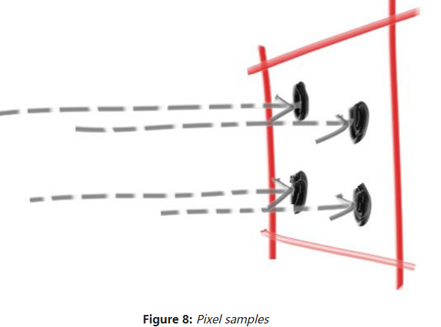
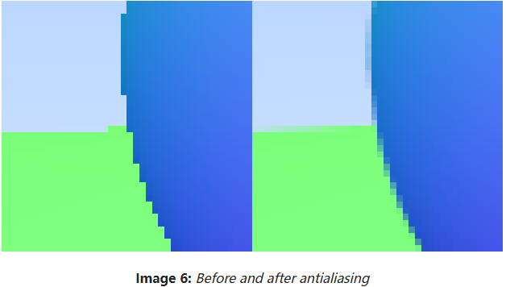
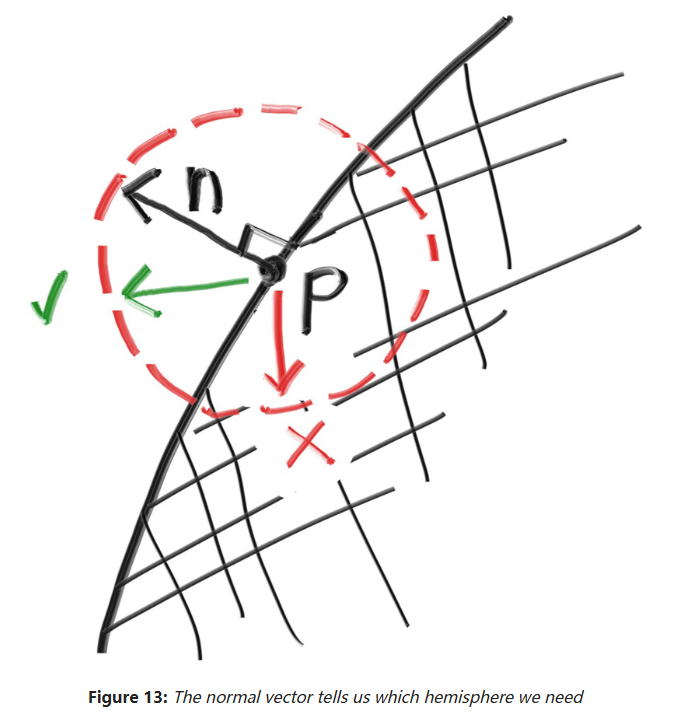

# RayTracingLearning
旨在记录光线追踪学习过程....

## SW
**SW means Solftware Raytracing**

### 1. 简单MSAA
the simplest model: sampling the square region centered at the pixel that extends halfway to each of the four neighboring pixels. This is not the optimal approach, but it is the most straight-forward.



### 2. simple diffuse material

#### Core definition
**Diffuse lighting** describes how light scatters uniformly when striking a rough surface. The incoming light hits surface particles and reflects in all directions, rather than bouncing as a sharp mirror reflection. The brightness seen depends on the angle between the light ray and the surface normal.

#### Standard formula (Lambertian diffuse, widely used in GPU shaders)
```
Diffuse = LightColor × SurfaceColor × max( dot(N, L), 0 )
```
- **N**: Surface normal vector (unit vector perpendicular to the surface)
- **L**: Light direction vector (unit vector pointing from surface point to light source)
- `dot(N, L)`: Dot product; it reaches maximum when light hits straight onto the surface, drops to zero when light grazes the surface, and clamped to avoid negative values (no negative light).

#### Plain English explanation (for presentation / tech vlog)
Diffuse lighting is the base component of real-time GPU rendering. It simulates matte materials like plaster, cloth or unpolished stone. These surfaces do not produce shiny highlights. The surface appears brightest where light faces it directly, and gradually darkens as the surface tilts away from the light.

#### Key terms list
- Lambertian diffuse 朗伯漫反射
- surface normal 表面法线
- light direction 光线方向
- dot product 点积
- albedo 反照率（漫反射基础颜色）
- light attenuation 光照衰减


## HW
**HW means Hardware Raytracing**
